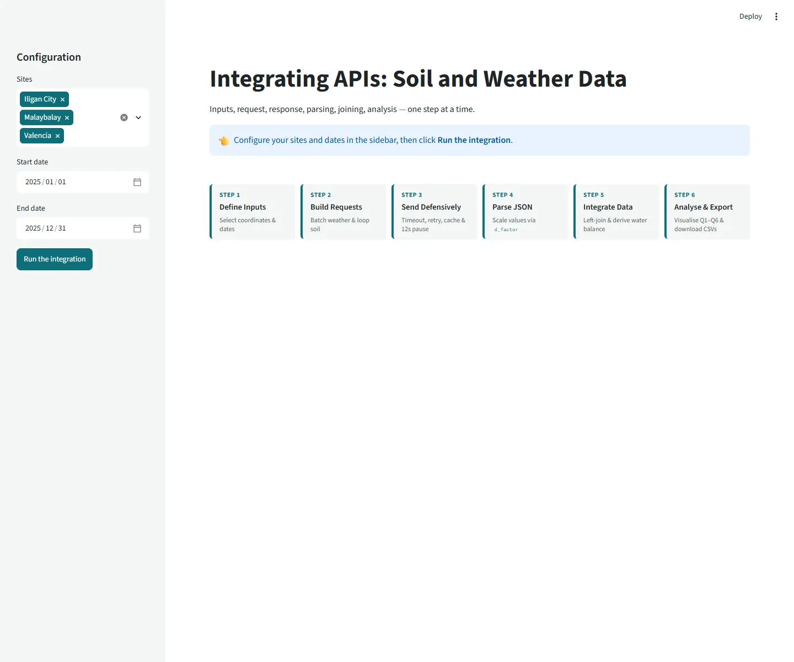
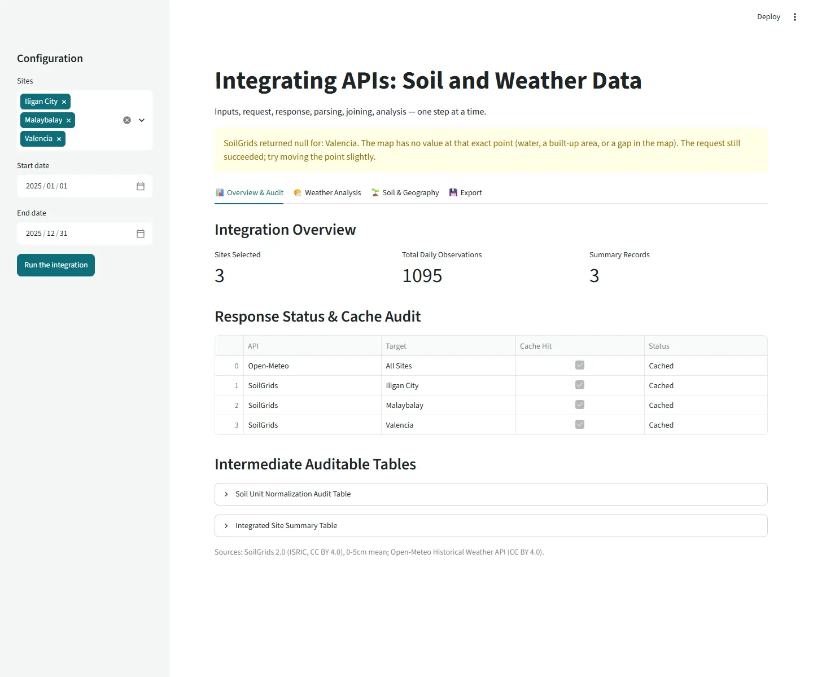
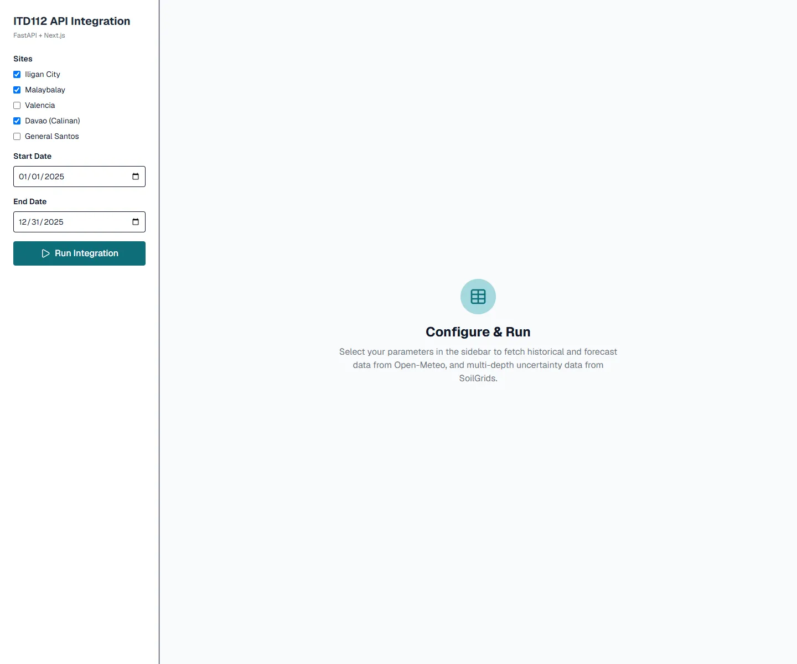
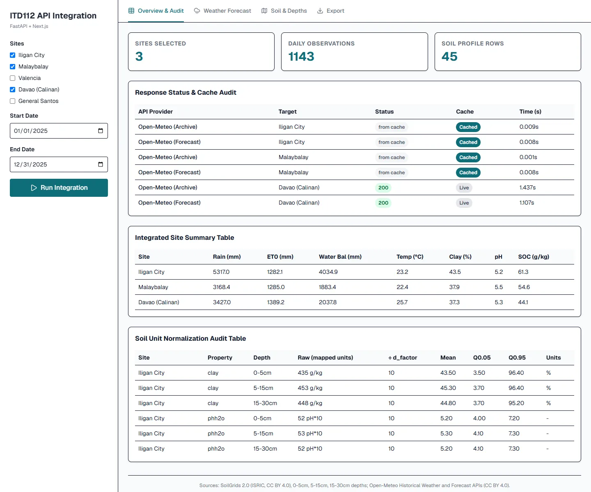
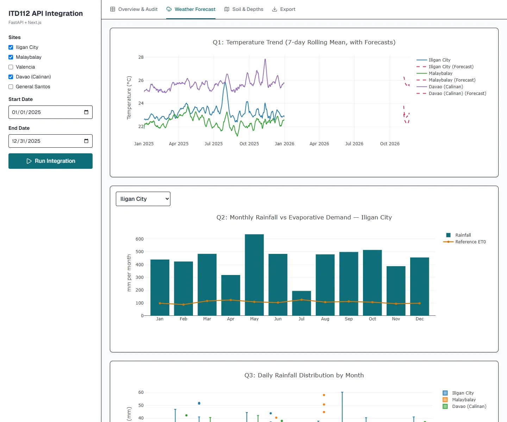
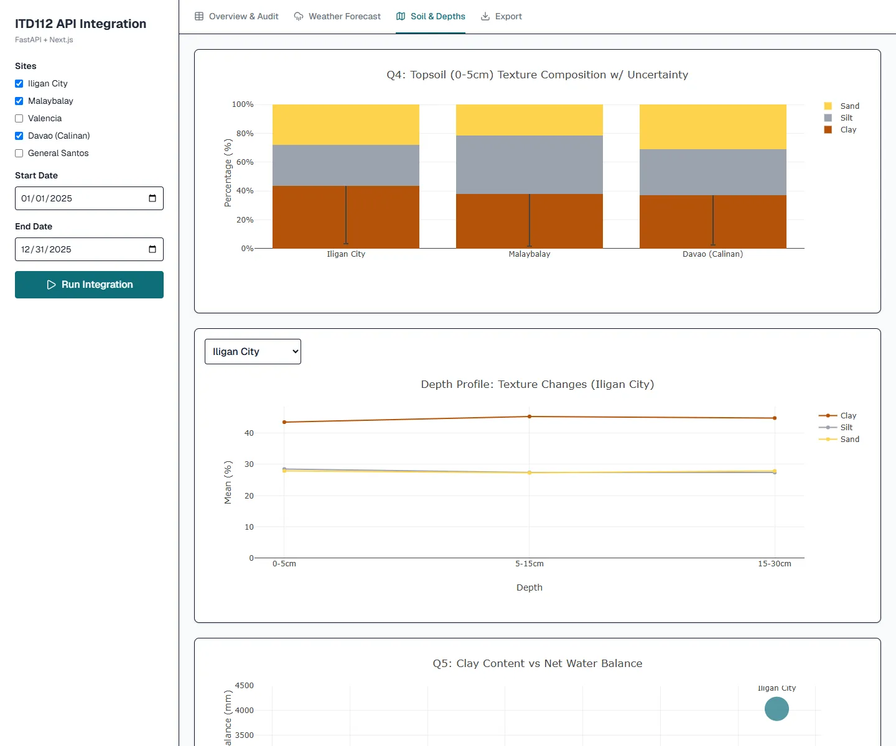
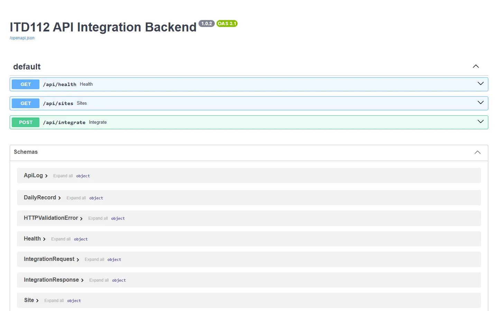

<div align="center" id="top">


# ITD112 API Integration

**Weather meets soil: combining Open-Meteo and SoilGrids data for five Mindanao sites.**


[](https://github.com/Jevoel16/api-app/actions/workflows/ci.yml)


[About](#about) · [Screenshots](#screenshots) · [Features](#features) · [Tech Stack](#tech-stack) · [Getting Started](#getting-started) · [Configuration](#configuration) · [Usage](#usage) · [More](#more) · [Contributing](#contributing) · [License](#license) · [Author](#author)

</div>

---

## About

This repository contains two complete versions of a web application that integrates weather data from the **Open-Meteo API** and soil properties from the **SoilGrids REST API** for five sites in Mindanao (Iligan City, Malaybalay, Valencia, Davao (Calinan) and General Santos).

You can run either:

- **Option 1 – Baseline version:** a lightweight Streamlit monolith (`streamlit_app.py`).
- **Option 2 – Advanced version:** a full-stack FastAPI backend (`backend/`) with a Next.js frontend (`frontend/`).

<p align="right"><a href="#top">back to top ↑</a></p>

---

## Screenshots

Click a thumbnail for the full-size image.

<details>
<summary><b>Screenshots</b></summary>
<br>

<table>
  <tr>
    <td width="50%" align="center"><b>Streamlit: start</b><br><a href="docs/images/streamlit-start.webp"></a></td>
    <td width="50%" align="center"><b>Streamlit: after a run</b><br><a href="docs/images/streamlit-baseline.webp"></a></td>
  </tr>
  <tr>
    <td width="50%" align="center"><b>Dashboard: start</b><br><a href="docs/images/dashboard-start.webp"></a></td>
    <td width="50%" align="center"><b>Overview &amp; Audit</b><br><a href="docs/images/dashboard-overview.webp"></a></td>
  </tr>
  <tr>
    <td width="50%" align="center"><b>Weather Forecast</b><br><a href="docs/images/weather-forecast.webp"></a></td>
    <td width="50%" align="center"><b>Soil &amp; Depths</b><br><a href="docs/images/soil-depths.webp"></a></td>
  </tr>
  <tr>
    <td width="50%" align="center"><b>API docs (Swagger UI)</b><br><a href="docs/images/api-docs.webp"></a></td>
    <td width="50%"></td>
  </tr>
</table>

</details>

<p align="right"><a href="#top">back to top ↑</a></p>

---

## Features

- Pick any of five Mindanao sites and a date range, and get weather and soil data joined per site and day.
- Compare temperature trends, monthly rainfall against evaporative demand and daily rainfall spread.
- See topsoil texture with uncertainty ranges, and how it changes down to 30 cm.
- Look ahead with the 16-day forecast alongside past weather.
- Audit every API call: HTTP status, cache hit or live, and timing.
- Download the site summary, daily records and soil profile as CSV.
- Fast repeat runs thanks to an on-disk response cache.

<p align="right"><a href="#top">back to top ↑</a></p>

---

## Tech Stack

| Layer | Tools |
| --- | --- |
| Baseline app | Python 3.13.3, Streamlit 1.66.1, Plotly 7.1.0, pandas 3.1.1, NumPy 2.5.4 |
| Backend | FastAPI 0.162.0, Uvicorn 0.54.0, Pydantic 2.14.2, requests 2.34.2 |
| Frontend | Node.js 22.14.0, Next.js 16.4.5, React 19.2.8, TypeScript 5.9.3, Tailwind CSS 4.3.3, Plotly.js 4.1.1 |
| Tests and CI | pytest 9.2.0, Vitest 5.1.0, GitHub Actions |
| Data | [Open-Meteo](https://open-meteo.com/) archive + forecast, [SoilGrids v2.0](https://rest.isric.org/) |

<p align="right"><a href="#top">back to top ↑</a></p>

---

## Getting Started

Prerequisites: Python 3.13 and Node.js 22. No API keys are needed.

```bash
git clone https://github.com/Jevoel16/api-app.git && cd api-app
python -m venv .venv && .venv\Scripts\activate     # macOS/Linux: source .venv/bin/activate
pip install -r requirements.txt -r backend/requirements.txt
streamlit run streamlit_app.py                      # baseline at http://localhost:8501
```

For the advanced version, run the backend and frontend in two terminals:

```bash
uvicorn backend.app.main:app --reload               # API at http://127.0.0.1:8000
cd frontend && npm install && npm run dev           # dashboard at http://localhost:3000
```

<p align="right"><a href="#top">back to top ↑</a></p>

---

## Configuration

Everything works with the defaults. To change them, copy [`.env.example`](.env.example) to `.env`, and [`frontend/.env.example`](frontend/.env.example) to `frontend/.env.local` for the backend URL.

<details>
<summary><b>Environment variables</b></summary>
<br>

| Variable | Default | Purpose |
| --- | --- | --- |
| `CACHE_DIR` | `./cache` | Disk cache for API responses |
| `FORECAST_TTL_S` | `10800` (3 h) | Age after which cached forecasts are refetched |
| `SOILGRIDS_PAUSE_S` | `12` | Pause between live SoilGrids calls (fair use) |
| `HTTP_TIMEOUT_S` | `300` | Timeout for one upstream request |
| `CORS_ORIGINS` | `http://localhost:3000,http://127.0.0.1:3000` | Origins allowed to call the backend |
| `NEXT_PUBLIC_API_URL` | `http://127.0.0.1:8000` | Backend URL used by the frontend (`frontend/.env.local`) |

Sites, API URLs and requested variables live in [`core/sources.py`](core/sources.py).

</details>

<p align="right"><a href="#top">back to top ↑</a></p>

---

## Usage

1. Open the dashboard (http://localhost:3000) or the Streamlit app (http://localhost:8501).
2. Tick the sites and set the start and end dates in the sidebar.
3. Click **Run Integration** (Streamlit: **Run the integration**).
4. Browse the tabs: Overview & Audit, Weather, Soil, and Export to download CSVs.

A first run with several sites takes a while because live SoilGrids calls are paced 12 s apart; later runs come from the cache. To call the backend directly, see the [API reference](docs/api.md).

<p align="right"><a href="#top">back to top ↑</a></p>

---

## More

<details>
<summary><b>Project structure</b></summary>
<br>

```text
api-app/
├── core/              # Shared data logic: config, sources, HTTP cache, parsing, pipeline
├── backend/           # FastAPI app (backend/app/)
├── frontend/          # Next.js dashboard
├── tests/             # pytest suite with offline API fixtures
├── docs/              # API reference and README screenshots
├── streamlit_app.py   # Baseline Streamlit app
└── VERSION            # Project version
```

</details>

<details>
<summary><b>Scripts</b></summary>
<br>

| Command | Where | What it does |
| --- | --- | --- |
| `streamlit run streamlit_app.py` | root | Start the baseline app on port 8501 |
| `uvicorn backend.app.main:app --reload` | root | Start the API on port 8000 |
| `python -m pytest` | root | Run the Python tests (offline) |
| `npm run dev` | `frontend/` | Start the dashboard on port 3000 |
| `npm run lint` / `npm test` / `npm run build` | `frontend/` | Lint, Vitest tests, production build |

</details>

<p align="right"><a href="#top">back to top ↑</a></p>

---

## Contributing

Use `feat/…` or `fix/…` branches and [Conventional Commits](https://www.conventionalcommits.org/) with the bumped version at the end of the subject, e.g. `feat: add CSV export (v1.4.0)`. Put shared data logic in `core/`, run the tests before committing, and update this README with every change.

<p align="right"><a href="#top">back to top ↑</a></p>

---

## License

Licensed under the Sprucetrap Source-Available License 1.0; see [LICENSE](LICENSE).

<p align="right"><a href="#top">back to top ↑</a></p>

---

## Author

**Sprucetrap** ([@Jevoel16](https://github.com/Jevoel16)) for ITD112 Laboratory Exercise 1: API Integration.

<p align="right"><a href="#top">back to top ↑</a></p>
